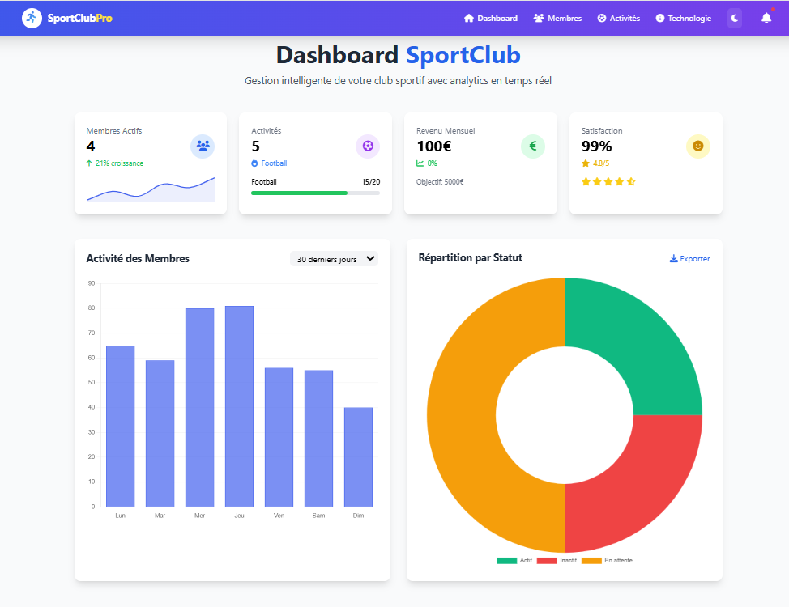
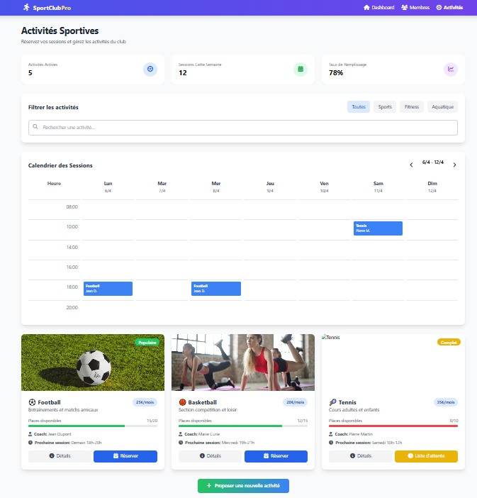
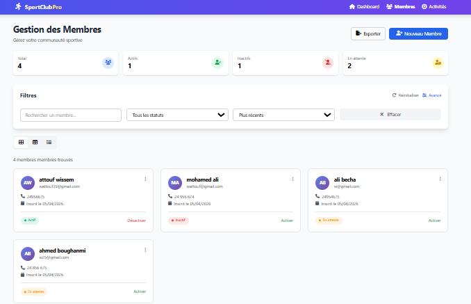

# Sport Club Management — Gestion d’un club sportif

Application web de gestion des membres d’un club sportif, développée avec **Java 17 et Spring Boot**. Le projet combine des pages web rendues avec Thymeleaf et une API REST documentée avec OpenAPI/Swagger.

<p align="center"><strong>Java 17 · Spring Boot · Maven · Thymeleaf · Spring Data JPA · H2 · Docker</strong></p>

## Présentation

L’application centralise les opérations courantes de consultation et de gestion des membres d’un club. Elle constitue également un projet pratique pour travailler sur l’architecture Spring Boot, la persistance JPA, la documentation d’API et l’automatisation des tests.

## 📸 Captures d’écran

### Aperçu de l’application

<p align="center">
  
</p>

### Gestion du club sportif

<p align="center">
  
</p>

### Vue complémentaire

<p align="center">
  
</p>

## Fonctionnalités

- Page d’accueil et pages de présentation du club.
- Consultation et gestion des membres.
- Recherche de membres par nom.
- Création, consultation, modification et suppression de membres.
- Comptage des membres.
- Documentation de l’API avec OpenAPI et Swagger UI.
- Tests automatisés avec l’écosystème Spring Boot Test.
- Configuration Docker pour construire et exécuter l’application.

## Démonstration

| Ressource | Lien |
|---|---|
| Application déployée | [Ouvrir l’application](https://sport-club-management-production-6f45.up.railway.app/) |
| Liste des membres | [GET /api/members](https://sport-club-management-production-6f45.up.railway.app/api/members) |
| Documentation Swagger | [Ouvrir Swagger UI](https://sport-club-management-production-6f45.up.railway.app/swagger-ui.html) |
| Spécification OpenAPI | [Consulter le document JSON](https://sport-club-management-production-6f45.up.railway.app/api-docs) |

> La configuration documentée utilise une base H2 en mémoire. Les données peuvent être réinitialisées au redémarrage de l’application. Une base persistante doit être configurée pour un usage durable.

## Technologies

- **Langage et framework :** Java 17, Spring Boot
- **Web :** Spring Web, Spring MVC, Thymeleaf
- **Persistance :** Spring Data JPA, H2
- **API :** OpenAPI, Swagger UI
- **Build et tests :** Maven, JUnit, Spring Boot Test
- **Déploiement et qualité :** Docker, GitHub Actions, configuration JaCoCo/SonarCloud

## Architecture

```text
sport-club-management/
├── .github/workflows/        # Workflows GitHub Actions
├── src/
│   ├── main/java/com/sportclub/
│   │   ├── controller/       # Contrôleurs MVC et REST
│   │   ├── model/            # Entités JPA
│   │   ├── repository/       # Accès aux données
│   │   └── service/          # Logique métier
│   ├── main/resources/
│   │   └── templates/        # Pages Thymeleaf
│   └── test/                 # Tests automatisés
├── Dockerfile
├── docker-compose.yml
├── pom.xml
└── README.md
```

## Routes principales

| Route | Description |
|---|---|
| `/` | Accueil |
| `/members` | Membres |
| `/about` | Présentation |
| `/activities` | Activités sportives |
| `/contact` | Contact |

## API REST

Base de l’API : `https://sport-club-management-production-6f45.up.railway.app/api/members`

| Méthode | Endpoint | Description |
|---|---|---|
| GET | `/api/members` | Lister les membres |
| GET | `/api/members/{id}` | Consulter un membre |
| POST | `/api/members` | Créer un membre |
| PUT | `/api/members/{id}` | Modifier un membre |
| DELETE | `/api/members/{id}` | Supprimer un membre |
| GET | `/api/members/search?name={nom}` | Rechercher par nom |
| GET | `/api/members/count` | Compter les membres |

Exemple de consultation :

```bash
curl https://sport-club-management-production-6f45.up.railway.app/api/members
```

## Installation locale

### Prérequis
- JDK 17
- Maven (ou le Maven Wrapper s’il est présent)
- Git

### Lancer le projet

```bash
git clone https://github.com/WissemAttouf/sport-club-management.git
cd sport-club-management
mvn spring-boot:run
```

Consultez la configuration du projet pour connaître le port et les paramètres actifs. Pour exécuter les tests :

```bash
mvn test
```

## Auteur

**Wissem Attouf** — Ingénieur logiciel | Développeur Full Stack  
[GitHub](https://github.com/WissemAttouf) · [LinkedIn](https://www.linkedin.com/in/wissem-attouf-452509226/) · [Portfolio](https://wissem-portfolio.vercel.app/) · [E-mail](mailto:wattouf35@gmail.com)
